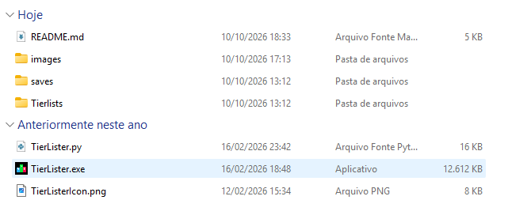
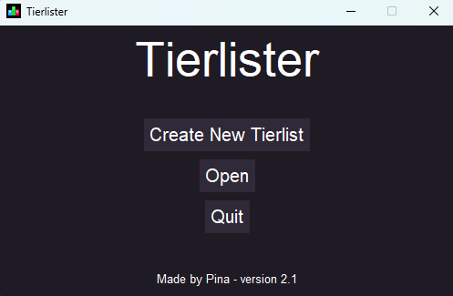
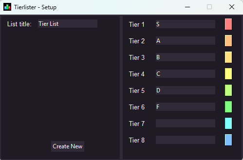
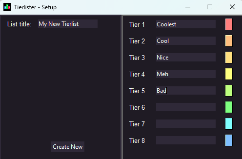
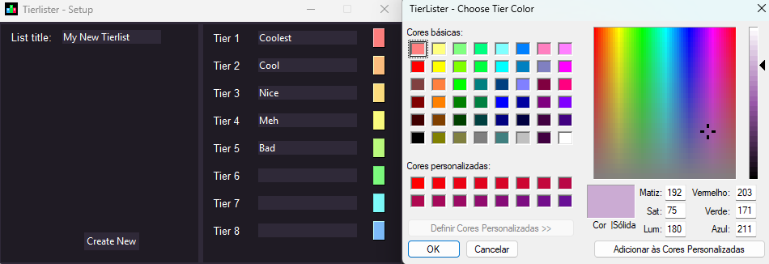
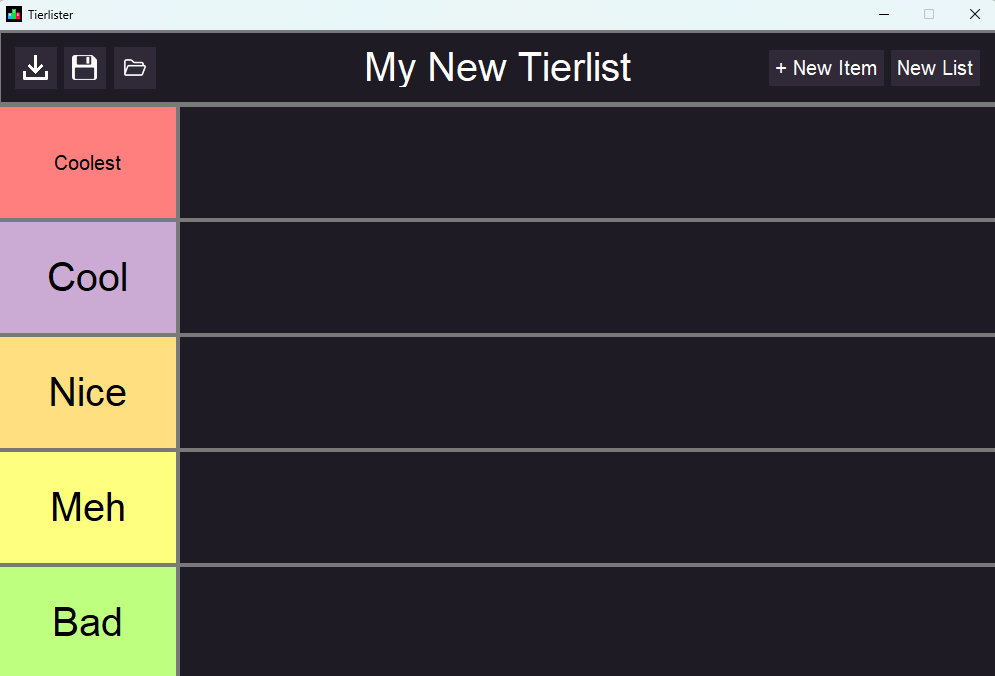
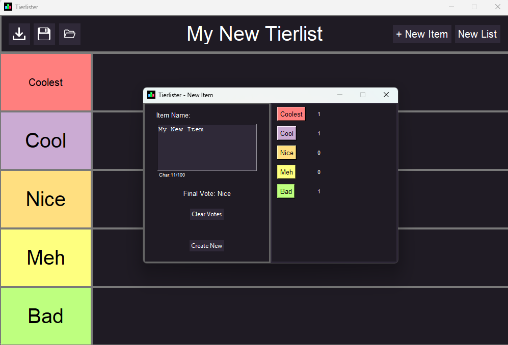
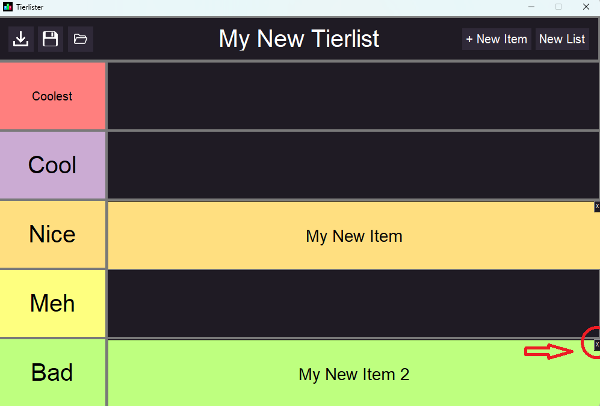
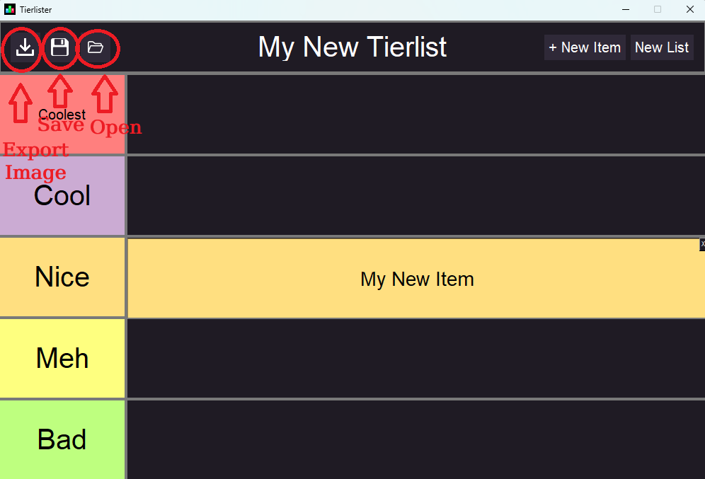

# Tierlister
TierLister é um programa para criação de tierlists, ou seja, listas em que os elementos estão ordenados em categorias crescentes, tipicamente representadas pelas letras F,D,C,B,A,S, sendo F o tier mais baixo e S o tier mais alto.

Além de possuir uso individual, ele foi projetado para atender a criação local de uma tierlist em grupo. Durante a definição do tier de um item na lista, é aberta uma votação em que cada membro do grupo seleciona qual item ele acredita que o item deve pertencer. O tier que o item pertence é o resultado do tier médio dessa votação.

O código foi feito em Python 3 com o uso majoritário da biblioteca Tkinter para implementação de uma UI gráfica em janela.

## Demonstração
Abra o executável na mesma pasta deste README:

Clique no botão "Create New Tierlist" para criar uma nova tierlist:

O menu de setup da nova tierlist vem por padrão com o título "New Tierlist" e com os tiers de S a F:

O título da tierlist, os nomes dos tiers e quntos tiers serão utilizados podem ser alterados:

A cor de cada tier da tierlist também pode ser alterada:

Após clicar no botão "Create New", a nova tierlist vazia está pronta para ser editada:

Clique no botão "New Item" para adicionar um novo item. Você deve escrever o conteúdo do novo item (texto de no máximo 100 caracteres) e selecionar o tier que ele fará parte seja por uma simples seleção, seja por meio do sistema de votação do tier:

Para remover um item da tierlist, bassta clicar no pequeno botão de "X" em seu canto superior direito:

É possivel exportar a imagem do estado atual da tierlist, salvar as edições da tierlist em um arquivo de texto e abrir uma tierlist salva anteriormente por meio dos 3 botões no canto superior esquerdo:

## Instalação e Requerimentos
### Requerimentos:
O programa funciona apenas no sistema operacional Windows.

### Instalação
Extraia a pasta ZIP "TierLister.zip" e a abra no Visual Studio Code.

O arquivo contém o executável "TierLister.exe" que pode ser usado para acesso imediato ao programa e alternativamente o arquivo contendo o código fonte em python "TierLister.py". 

Para usar a versão em python, instale o Python 3 e a extensão de python da Microsoft para o VS Code. 

Download do Python: https://www.python.org/downloads/
Extensão: https://marketplace.visualstudio.com/items?itemName=ms-python.python

O programa depende da biblioteca do Python Pillow. Para instalá-la, abra o Prompt de Comando e digite no terminal:
'''pip install Pillow'''

Após a instalação estar finalizada, escolha a opção "Run Python File in Terminal" na aba Run do menu do VS Code. Se for necessário, selecione o Python 3 como interpretador. Após rodar o programa, uma janelá abrirá.

## Uso
### Menu Inicial
Ao executar o programa, uma tela de menu disponibiliza 3 opções:
* Create New Tierlist: abre a caixa de criação "Setup" de uma nova tierlist do zero.
* Open: permite selecionar um arquivo de texto com os dados de uma tierlist feita anteriormente com o programa para continuar sua edição.
* Quit: fecha o programa.

### Setup De Uma Nova Tierlist
Ao selecionar a opção "Create New Tierlist", a tela de setup permite a personalização de dois aspectos da nova tierlist que será criada:
* Título da Tierlist (List Title): permite a definição de um título para a tierlist.
* Nome dos Tiers: Permite a personalização do nome e da cor de cada tier bem como a quantidade de tiers da tierlist, de 2 a 8 tiers. Preencha os nomes dos tiers de cima para baixo, sendo tier 1 o tier superior até o tier inferior. Tiers cujo nome estiverem em branco não serão considerados na criação da tierlist. Para mudar a cor de um tier, basta selecionar o quadrado colorido ao lado do nome do tier, o que exibirá uma janela com um seletor de cores.

### Edição da Tierlist
Após a criação de uma nova tierlist, há diversas opções para inserção e remoção de itens:

* Novo Item (New Item): abre a janela que permite adicionar um novo item à tierlist. Você deve digitar o conteúdo do novo item adicionado, que consiste em um texto de no máximo 100 caracteres. Após isso, você deve decidir a qual tier o item vai pertencer. Se essa escolha for feita por um usuário individualmente, basta selecionar uma das opções de tier a direita apenas uma vez e clicar em "Create New". Se a escolha estiver sendo feita por um grupo de pessoas, basta selecionar o tier que cada membro do grupo pensa que o item deve pertencer. Será então calculada a média das escolhas feitas e será decidido um rank médio para o item, que aparece no campo "Final Vote". Caso algum erro seja cometido, basta selecionar a opção "Clear Votes" para refazer a votação. Após a criação do novo item, ele deve aparecer em seu respectivo tier na tierlist.

* Remover Item: para remover um item, basta clicar no pequeno botão de "x" no canto superior direito de um item presente na tierlist.

* Nova Lista (New List): cria uma nova tierlist vazia. Se a tierlist atual não tiver sido salva, ela é perdida.

* Exportar Imagem da Tierlist: para exportar uma imagem do estado atual da tierlist, basta clicar no botão do canto superior esquerdo com um símbolo de seta para baixo. A imagem será salva na pasta /Tierlists que fica na mesma pasta que o executável.

* Salvar Tierlist: para salvar as alterações feitas na tierlist dentro do programa, basta clicar no botão do canto superior esquerdo com um símbolo de disquete. Os dados da tierlist serão salvos na pasta /saves que fica no mesma pasta do executável, na forma de um arquivo de texto cujo nome é o título da tierlist que poderá ser aberto para continuar a edição da tierlist em outra seção.

* Abrir Tierlist: para abrir uma tierlist anteriormente salva e continuar a edição, basta clicar no botão do canto superior esquerdo com um símbolo de uma pasta de arquivos. Será aberta uma janela do explorador de arquivos na pasta /saves em que um arquivo de texto com o nome referente ao título da tierlist que se deseja abrir poderá ser selecionado, o que abrirá a tierlist no programa.

## Estrutura
Os arquivos presentes são:
* README.md: este arquivo README que contém as especificações e instruções sobre como utilizar o programa.
* LICENSE.txt: arquivo de texto que contém os detalhes acerca da licensa adotada neste projeto.
* /images: pasta contendo as imagens dos ícones usados nos botões do programa.
* /saves: pasta que contém as tierlists salvas como arquivos de texto, cujos nomes são os títulos das referentes tierlists.
* /Tierlists: pasta que contém as imagens exportadas das tierlists feitas no programa.
* /assets: pasta contendo imagens utilizadas neste README.
* TierLister.py: código fonte em python do programa.
* TierLister.exe: executável do programa.

## Licença
A licença adotada neste projeto é a MIT LICENSE, disponível aqui: [LICENSE.txt](./LICENSE.txt)